<picture>
  <source media="(prefers-color-scheme: dark)" srcset="assets/hero-dark.svg">
  
</picture>

  <a href="https://www.linkedin.com/in/umang-bagadi"><b>LinkedIn</b></a> &nbsp;·&nbsp;
  <a href="https://x.com/BagadiUmang"><b>X / Twitter</b></a> &nbsp;·&nbsp;
  <a href="#selected-work"><b>Selected work</b></a> &nbsp;·&nbsp;
  <a href="#how-i-build"><b>How I build</b></a>

Most agent demos trust whatever the model writes. Mine don't. I treat an LLM like a smart but fallible junior engineer: it reads, ranks and explains, and plain, tested code decides what counts as true, what's allowed, and whether it worked.

## Selected work

🟪 the LLM proposes &nbsp; 🟨 code decides &nbsp; 🟩 a human approves &nbsp; ⤺ the agent corrects itself

<a href="https://github.com/umangbagadi03/incidentpilot">
  <picture>
    <source media="(prefers-color-scheme: dark)" srcset="assets/card-incidentpilot-dark.svg">
    
  </picture>
</a>

<a href="https://github.com/umangbagadi03/argus">
  <picture>
    <source media="(prefers-color-scheme: dark)" srcset="assets/card-argus-dark.svg">
    
  </picture>
</a>

<a href="https://github.com/umangbagadi03/kasauti">
  <picture>
    <source media="(prefers-color-scheme: dark)" srcset="assets/card-kasauti-dark.svg">
    
  </picture>
</a>

## How I build

**01 · The LLM proposes, the code decides.**
Models read, rank and explain. Verdicts, policies and "did it work?" are deterministic code you can unit-test.

**02 · Every claim cites its evidence.**
If a sentence can't point to the log line, source or label it came from, confidence drops and a human takes over.

**03 · Nothing irreversible without a human.**
Agents investigate with read-only tools. Changes pass a policy check, then pause for approval, even across restarts.

**04 · If it isn't evaluated, it doesn't work.**
Adversarial scenarios (red herrings, failed first fixes, prompt injection, no-answer cases) run before I trust a demo.

## Stack

<picture>
  <source media="(prefers-color-scheme: dark)" srcset="assets/stack-dark.svg">
  
</picture>

<b>Before agents: the 2021–2023 archive</b>

 

Computer vision, NLP and classic ML, from my first years of building.

| Project | What it is |
|---|---|
| [Dino game with facial recognition](https://github.com/umangbagadi03/Dino-game-using-facial-recognition) | Chrome's T-Rex game, played with facial expressions via OpenCV |
| [AIPS-3 semantic search](https://github.com/umangbagadi03/AIPS-3) | AI-powered smart search: find the exact passage in a book or PDF |
| [Auto-ML app](https://github.com/umangbagadi03/Auto-ML-App) | Bring a dataset; it handles features, model selection and tuning |
| [MLOps](https://github.com/umangbagadi03/MLOPS) | A reproducible ML pipeline versioned with DVC |
| [Stock market forecasting](https://github.com/umangbagadi03/Stock-Market-Forecasting) | Stacked-LSTM price forecasting |
| [Twitter sentiment analysis](https://github.com/umangbagadi03/Twitter_Sentiment_Analysis) | NLP sentiment classifier for tweets |
| [Song recommender](https://github.com/umangbagadi03/Song-Recommendation-System) | Spotify-style song recommendations, served as a web app |
| [SMS spam classifier](https://github.com/umangbagadi03/SMS-SPAM-CLASSIFIER) | Spam vs ham with classic NLP features |
| [Data structures & algorithms](https://github.com/umangbagadi03/Data_Structure_Algorithm) | C++ solutions from my DSA practice |

 

<picture>
  <source media="(prefers-color-scheme: dark)" srcset="assets/footer-dark.svg">
  
</picture>
