<picture>
  <source media="(prefers-color-scheme: dark)" srcset="assets/hero-dark.svg">
  
</picture>

  <a href="https://www.linkedin.com/in/umang-bagadi"><b>LinkedIn</b></a> &nbsp;·&nbsp;
  <a href="https://x.com/BagadiUmang"><b>X / Twitter</b></a> &nbsp;·&nbsp;
  <a href="#what-i-build"><b>What I build</b></a> &nbsp;·&nbsp;
  <a href="#how-i-build"><b>How I build</b></a>

Most agent demos trust whatever the model writes. Mine don't. I treat an LLM like a smart but fallible junior engineer: it reads, ranks and explains, and plain, tested code decides what counts as true, what's allowed, and whether it worked.

## What I build

🟪 the LLM proposes &nbsp; 🟨 code decides &nbsp; 🟩 a human approves

<picture>
  <source media="(prefers-color-scheme: dark)" srcset="assets/skills-dark.svg">
  
</picture>

## How I build

**01 · The LLM proposes, the code decides.**
Models read, rank and explain. Verdicts, policies and "did it work?" are deterministic code you can unit-test.

**02 · Every claim cites its evidence.**
If a sentence can't point to the log line, source or label it came from, confidence drops and a human takes over.

**03 · Nothing irreversible without a human.**
Agents start with read-only tools. Changes pass a policy check, then pause for approval, even across restarts.

**04 · If it isn't evaluated, it doesn't work.**
Adversarial scenarios (red herrings, failed first fixes, prompt injection, no-answer cases) run before I trust a demo.

## The GenAI stack

<picture>
  <source media="(prefers-color-scheme: dark)" srcset="assets/stack-dark.svg">
  
</picture>

 

<picture>
  <source media="(prefers-color-scheme: dark)" srcset="assets/footer-dark.svg">
  
</picture>

My latest projects are pinned below ↓

